<!--
  Profile README for github.com/fouad-barkaoui
  Every visual in /assets is a hand-built animated SVG (no external fonts, scripts or APIs),
  so nothing here can break when a third-party stats service goes down.
  Regenerate the assets with:  python3 tools/build_assets.py assets
-->

  

  

  

  

  

  

  

  

<picture>
  <source media="(prefers-color-scheme: dark)" srcset="https://raw.githubusercontent.com/fouad-barkaoui/fouad-barkaoui/output/snake-dark.svg">
  <source media="(prefers-color-scheme: light)" srcset="https://raw.githubusercontent.com/fouad-barkaoui/fouad-barkaoui/output/snake-light.svg">
  
</picture>

  

