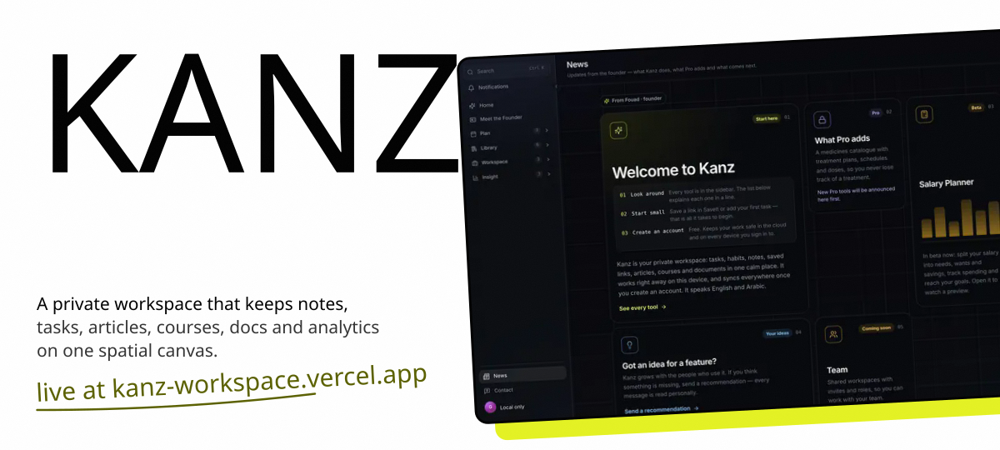
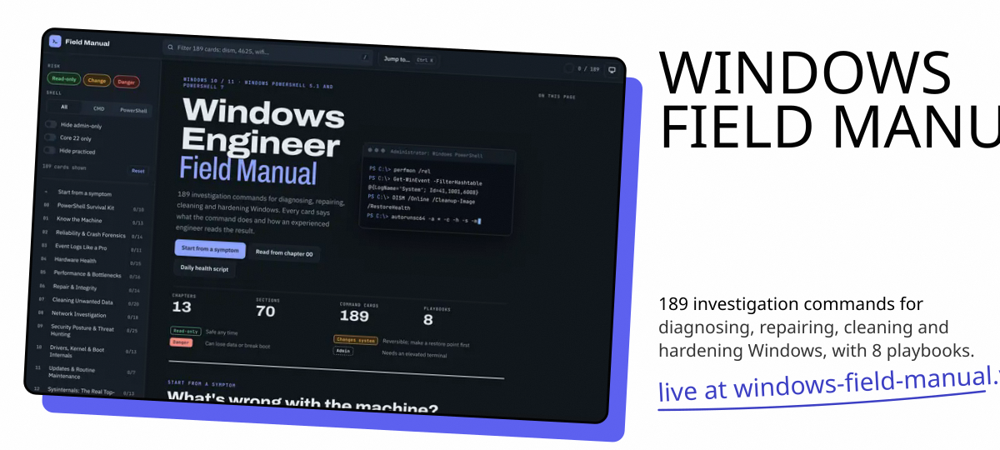
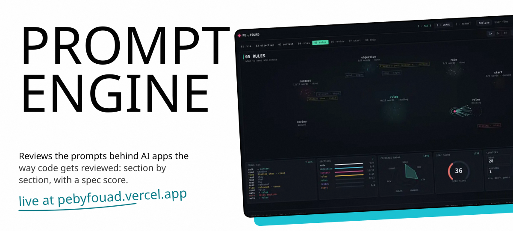
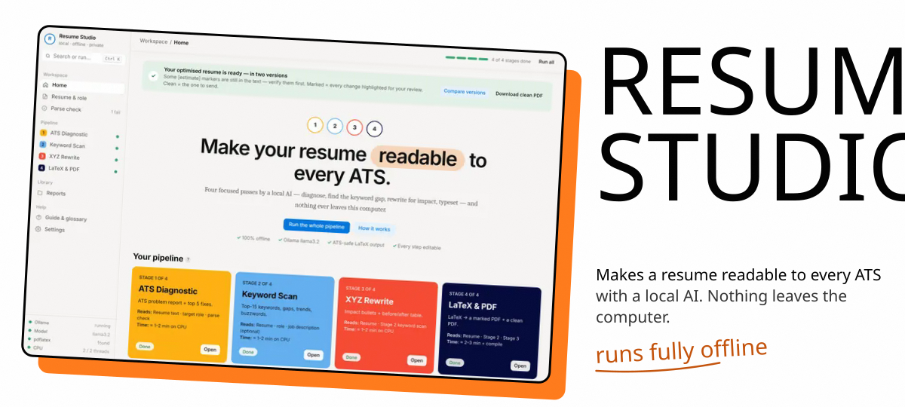
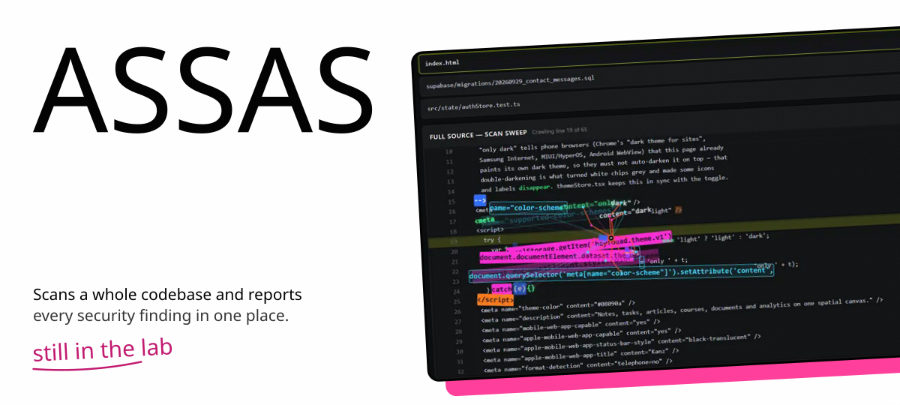
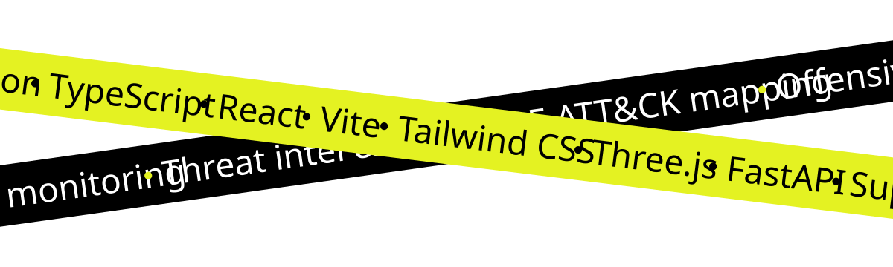
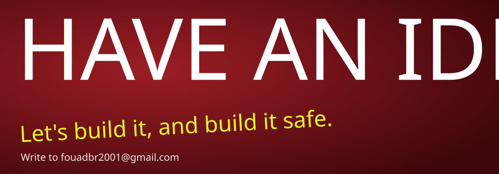

<!--
  Poster-style profile README. Every image in /assets is a self-contained SVG with its fonts
  (Anton, Caveat, Source Sans 3) and pictures embedded, rebuilt with tools/build_readme_assets.py.
-->

  

 

  

<a href="https://fouad-barkaoui.vercel.app">Portfolio</a>&emsp;&emsp;<a href="https://www.linkedin.com/in/fouad-barkaoui/">LinkedIn</a>&emsp;&emsp;<a href="https://www.instagram.com/heyfouad/">Instagram</a>&emsp;&emsp;<a href="mailto:fouadbr2001@gmail.com">Email</a>

