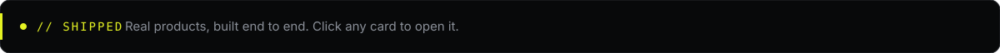
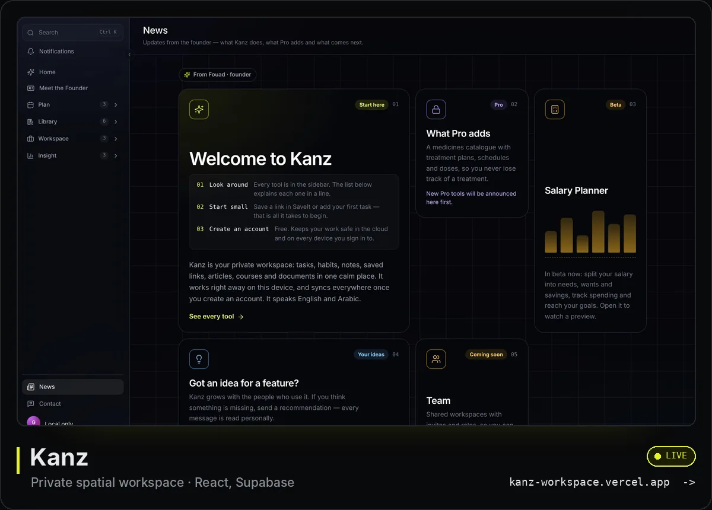
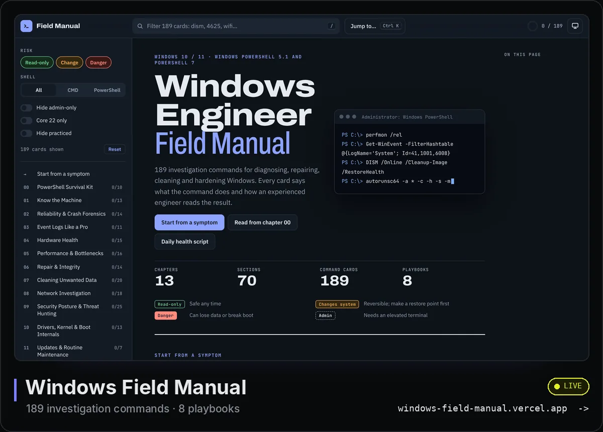
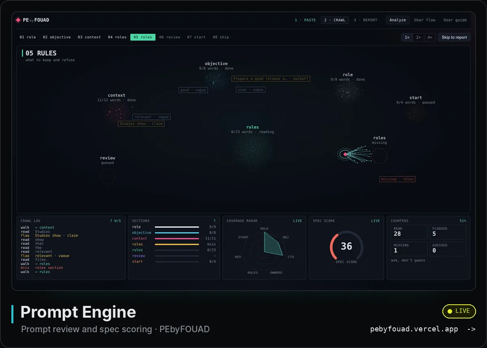
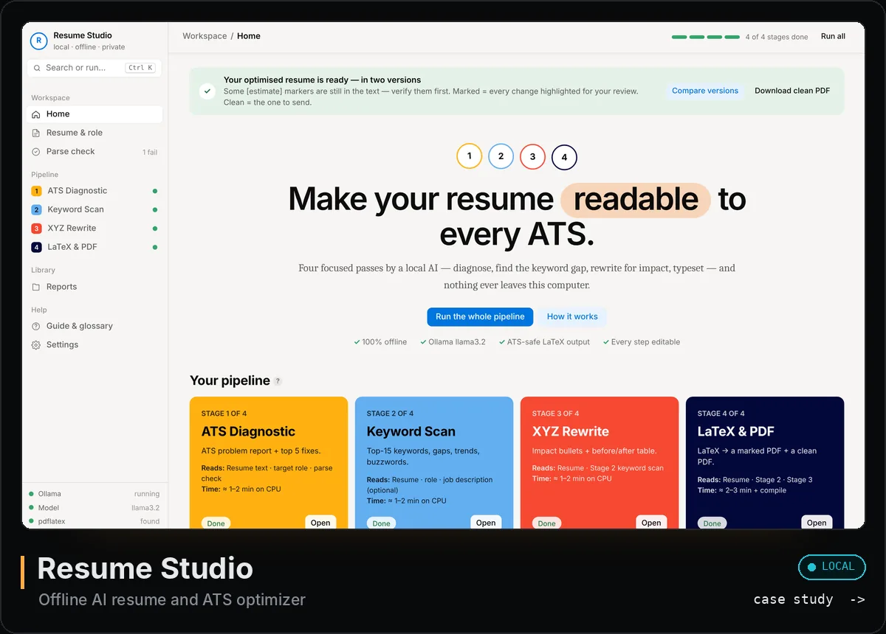
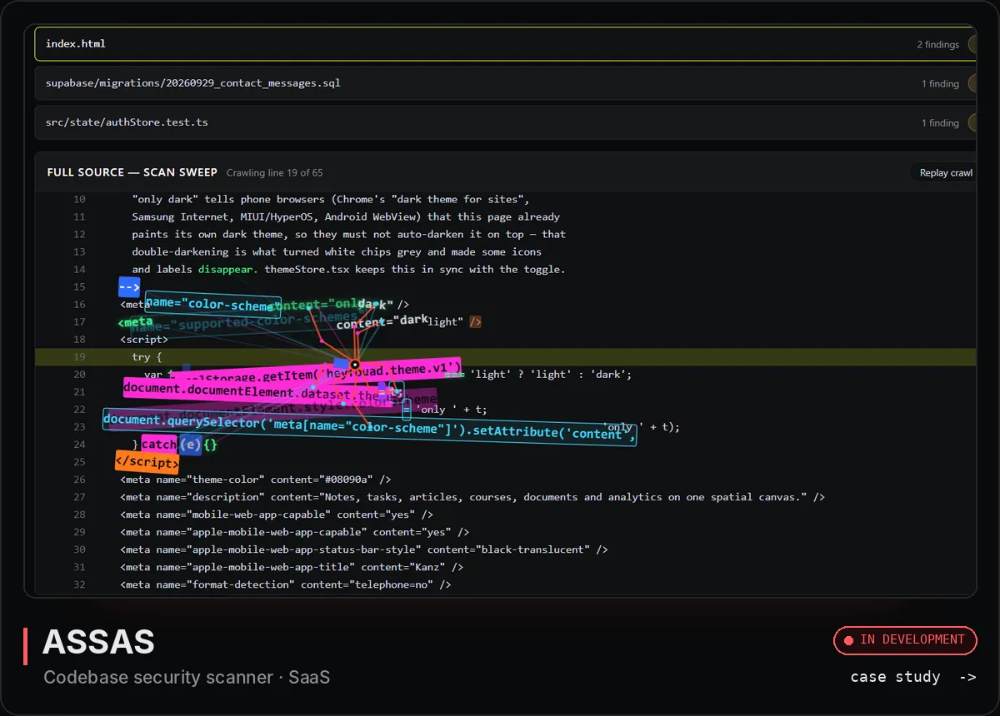
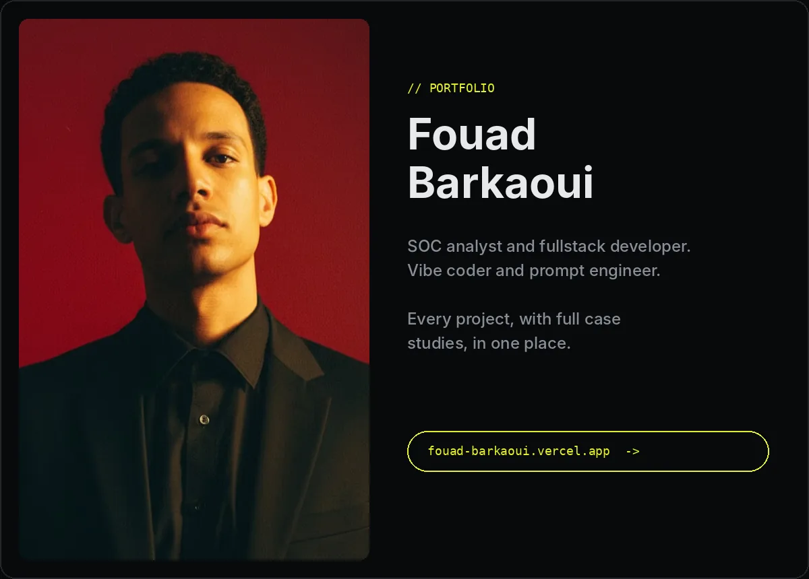

<!--
  Profile README for github.com/fouad-barkaoui
  /assets/*.svg are hand-built animated SVGs (no external fonts, scripts or APIs): python3 tools/build_assets.py assets
  /assets/work/*.webp are framed screenshots from the portfolio repo: python3 tools/build_project_cards.py <portfolio>/src/assets assets/work
-->

  

  

  

  

  

  

  

  

<picture>
  <source media="(prefers-color-scheme: dark)" srcset="https://raw.githubusercontent.com/fouad-barkaoui/fouad-barkaoui/output/snake-dark.svg">
  <source media="(prefers-color-scheme: light)" srcset="https://raw.githubusercontent.com/fouad-barkaoui/fouad-barkaoui/output/snake-light.svg">
  
</picture>

  

